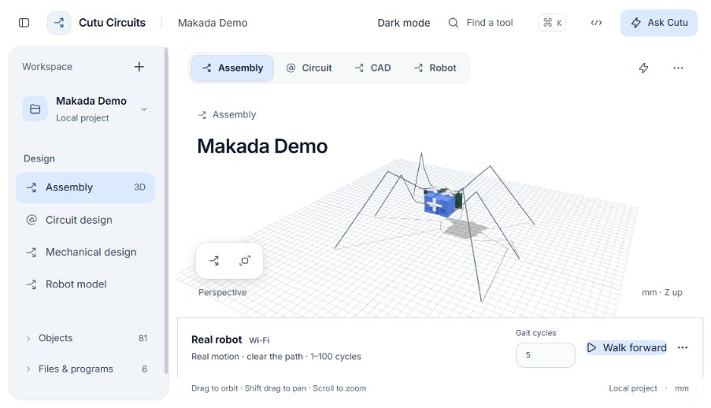

<div align="center">

# Cutu Circuits

### Build electronics. Bring them to life.

A workspace where circuits, mechanical design, firmware and AI work on the same project.

[Get started](#try-cutu) · [Meet Makada](#meet-makada) · [Connect Codex](cutu-circuits/plugins/cutucircuits/README.md)

</div>



## One project, from circuit to robot

Building a robot usually means carrying context between a circuit editor, a CAD tool, firmware files and an AI chat. Cutu brings those pieces into one workspace, so you can move from a wiring question to a design change to a hardware command with the project beside you.

Open the assembly. Inspect a circuit. Change a part. Ask the agent to check your assumptions. Then connect the real device and see it move.

## Meet Makada

Makada is our six-legged, three-servo robot, powered by a NodeMCU. It is the project you can explore inside Cutu—and the physical robot we use to demonstrate the workflow.

**“Build Makada.”** The assembly comes together over a smooth, 37-second sequence: servo bodies, horns, each leg individually, then the controller and wiring. The presentation ends with the complete robot, ready to inspect.

Switch between **Assembly**, **Circuit**, **CAD** and **Robot** to explore how the pieces fit together. Ask Cutu to explain the wiring or research a component. With calibrated hardware connected over Wi-Fi, choose a gait count and press **Walk forward** to command the real Makada.

The assembly show is visual; walking is a separate, explicit hardware action. A gait cycle describes the commanded sequence, not a measured distance.

## Design with an agent beside you

The assistant lives next to the design, with access to the project you are working on.

- **Understand the build.** Ask about source files, components, connections and device programs.
- **Check the details.** Use Exa to find public component documentation and bring back cited sources.
- **Make a change together.** Review proposed edits and approve changes before they are applied.
- **See the work happen.** Streaming answers, tool activity and approvals stay in the conversation.
- **Go deeper with Codex.** Connect the local plugin for larger engineering tasks through the same project runtime.

Cerebras powers the embedded assistant. Exa supplies web research. The providers are separate modules, while the project runtime coordinates files, tools and permissions.

## Explore, test, build

| In Cutu | What you can do |
| --- | --- |
| **Assembly** | Inspect the full build in 3D and present Makada coming together |
| **Circuit** | Edit native circuit source, inspect connections and export engineering outputs |
| **CAD** | Work on mechanical geometry and export manufacturing files |
| **Robot** | Inspect URDF models, move joints and explore rigid-body simulation |
| **Hardware** | Run project-owned device programs with telemetry and Stop controls |

Source files remain editable. Project history and guarded writes make changes inspectable. The light and dark themes let you work at your desk or present on a bright screen.

## Try Cutu

On Windows, install **Node.js 24+**, then run these commands in PowerShell from the repository root:

```powershell
.\Setup-Workspace.ps1
.\Start-Workspace.ps1
```

Open **http://127.0.0.1:4310/** and choose **Makada Demo → Assembly**. Setup installs the dependencies and prepares Python when needed; the launcher builds and warms the demo assets.

To enable the assistant and web research, copy `.env.local.example` to `.env.local`, add your **Cerebras** and **Exa** keys, and restart the launcher. The design workspace works without provider keys.

For the assembly presentation, keep the Assembly view open and ask a connected assistant to **build Makada**, or run this in a second terminal:

```powershell
. .\Activate-Workspace.ps1
node scripts/build-makada.mjs
```

Physical walking requires a commissioned, calibrated robot and private connection settings. See the [hardware and walking guide](cutu-circuits/docs/presentation-and-walking.md) before using the real robot controls. The simulator and commanded telemetry do not measure real-world pose or travel.

<details>
<summary><strong>For developers</strong></summary>

The frontend is in `cutu-circuits/apps/web`. The shared runtime, hardware runner and Codex plugin are under `cutu-circuits/packages`. `Cerebras/` and `Exa/` contain the isolated provider integrations. Makada's source, firmware and controller adapter live in `cutu-circuits/examples/spidey`.

```powershell
.\workspace.ps1 run typecheck
.\workspace.ps1 test
.\workspace.ps1 run build
.\workspace.ps1 run demo:check
```

Latest checks: **131 tests passed**, zero failures, one platform-specific skip. Typecheck, application/plugin build and presentation/control browser checks passed. Hardware UI tests use a fake device; real Wi-Fi walking has been exercised separately, and longer runs can be interrupted by connection loss.

[Development guide](cutu-circuits/README.md) · [Plugin setup](cutu-circuits/plugins/cutucircuits/README.md) · [Demo runbook](cutu-circuits/docs/demo-runbook.md)

</details>

---

Built on [Cutu](https://github.com/rtx09x/cutu). [Third-party notices](cutu-circuits/THIRD-PARTY-NOTICES.md).
